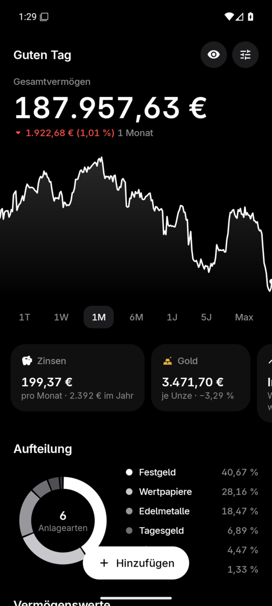
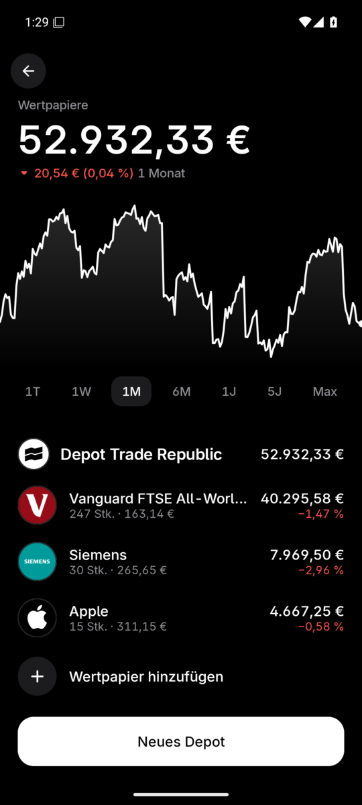
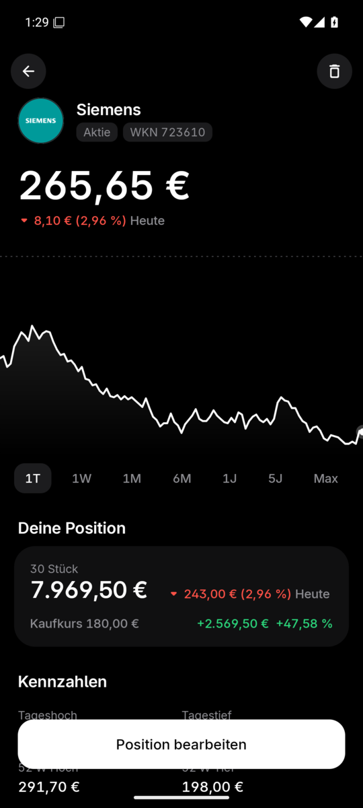
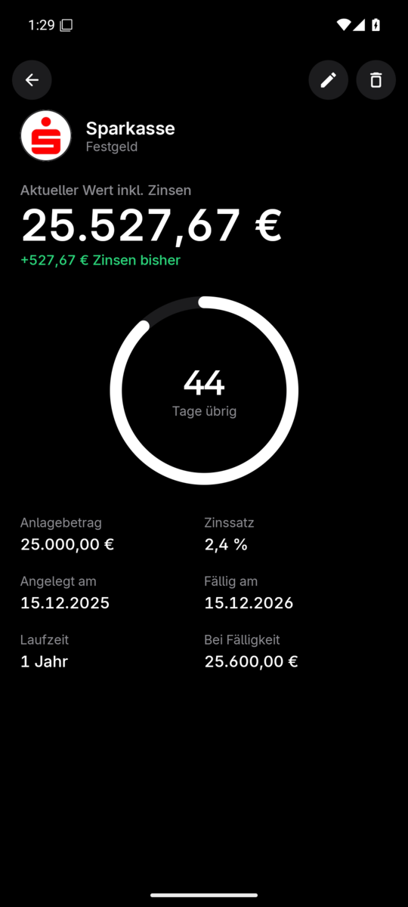
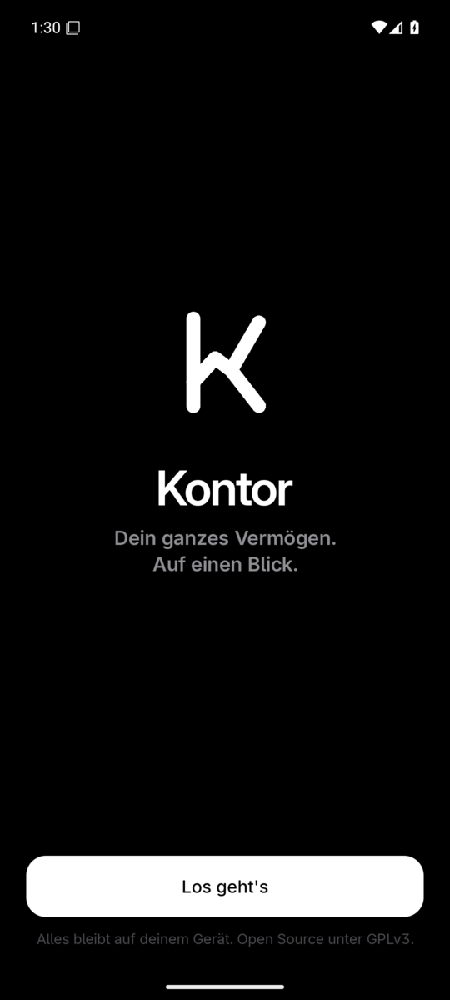
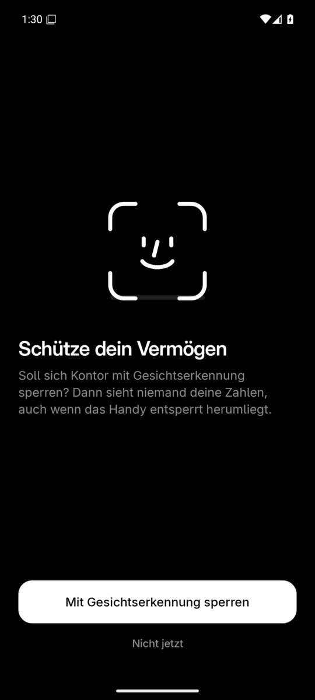
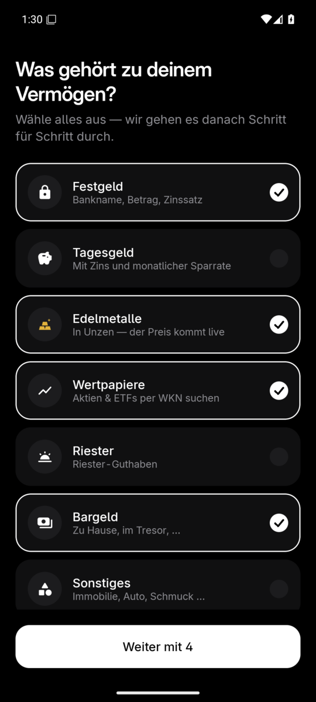
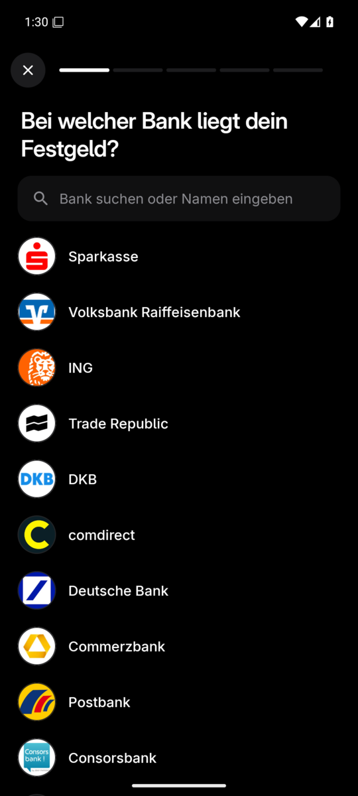
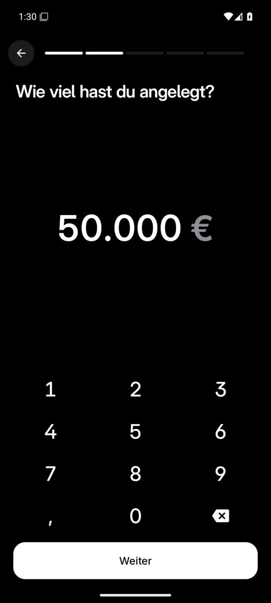

<p align="center">
  
</p>

<h1 align="center">Kontor</h1>

<p align="center">
  <b>Dein ganzes Vermögen. Auf einen Blick.</b><br/>
  Festgeld, Tagesgeld, Gold, Aktien &amp; ETFs, Riester und Bargeld in einer ruhigen Schwarz-Weiß-App für Android.
</p>

<p align="center">
  <a href="https://github.com/Felitendo/kontor/releases/latest"></a>
  <a href="https://github.com/Felitendo/kontor/releases/tag/dev"></a>
  <a href="LICENSE"></a>
</p>

<p align="center">
  
  
  
  
</p>

## Was Kontor kann

- **Willkommenstour** – beim ersten Start fragt Kontor nach der App-Sperre und geht danach alle Anlagearten Schritt für Schritt durch. Am Ende zählt das Gesamtvermögen hoch.
- **Festgeld** – Bank mit Logo (über 50 deutsche Banken, Broker und Versicherer), Betrag, Zinssatz und Laufzeit. Zeigt die bisher aufgelaufenen Zinsen, den Wert bei Fälligkeit und einen Countdown-Ring. Erinnert 30 und 7 Tage vor Ablauf.
- **Tagesgeld** – mit Zinssatz und monatlicher Sparrate. Kontor rechnet den Kontostand selbst weiter und zeigt eine Prognose über 1 bis 20 Jahre.
- **Edelmetalle** – Gold, Silber und Platin in Unzen, Gramm oder Euro. Der Spotpreis kommt live, die Umrechnung passiert beim Tippen.
- **Wertpapiere** – Suche nach **WKN**, ISIN oder Name (z. B. `A1JX52`), Stückzahl und optional der Kaufkurs. Live-Kurse in Euro, Charts von 1 Tag bis Max mit Finger-Scrubbing, Tageshoch und -tief, 52-Wochen-Spanne und Gewinn/Verlust. Mehrere Depots möglich.
- **Riester** – Guthaben, optionaler Zinssatz und Eigenbeitrag.
- **Bargeld & Sonstiges** – Tresor, Geldbörse, Immobilie, Auto …
- **Gesamtvermögen** – rollende Ziffern, Verlaufs-Chart über alle Anlagen, Aufteilung als Donut, Zinsen pro Monat, nächste Fälligkeit.
- **Prognose** – wohin sich das Vermögen in 1 bis 30 Jahren entwickeln kann, mit einstellbarer Wertpapierrendite.
- **Widgets** – Gesamtvermögen mit Verlauf, Depot mit größten Positionen, Goldpreis. Beträge im Widget lassen sich ausblenden.
- **Gesichtserkennung** – Sperre per Gesicht, Fingerabdruck oder PIN. Kontor ist im App-Wechsler dann unkenntlich.
- **Haptik & Animationen** – jede Taste, jeder Chart-Punkt und jedes Speichern hat ein eigenes Vibrationsmuster. Zahlen rollen, Charts zeichnen sich, Karten federn.
- **Beträge verbergen** – ein Tipp auf das Gesamtvermögen.
- **Sicherung** – Export und Import als JSON, außerdem Android-Backup.
- **Updates** – Kontor sucht selbst nach neuen Versionen und installiert sie. In den Einstellungen lässt sich zwischen **Stable** und **Dev** wechseln.

<p align="center">
  
  
  
  
  
</p>

## Installieren

1. Die neueste `Kontor-x.y.z.apk` von den [Releases](https://github.com/Felitendo/kontor/releases/latest) herunterladen.
2. Öffnen und die Installation aus dieser Quelle erlauben.
3. Fertig – ab jetzt aktualisiert sich Kontor selbst.

### Stable und Dev

| Kanal  | Woher                                                   | Für wen                         |
|--------|---------------------------------------------------------|---------------------------------|
| Stable | getaggte Releases (`v1.2.0`)                             | alle                            |
| Dev    | automatischer Build jedes Commits auf `main` ([`dev`](https://github.com/Felitendo/kontor/releases/tag/dev)) | wer Neues zuerst sehen will |

Beide Kanäle sind mit demselben Schlüssel signiert, ein Wechsel aktualisiert also einfach die installierte App. Wer von Dev zurück auf Stable geht, bleibt auf seiner Dev-Version, bis eine neuere Stable erscheint. Android erlaubt kein Downgrade ohne Datenverlust.

## Datenschutz

Alle Daten liegen nur auf dem Gerät. Kontor hat keinen Server, kein Konto und kein Tracking. Abgerufen werden nur:

| Wofür                     | Quelle |
|---------------------------|--------|
| Wertpapiersuche (WKN/ISIN) | Onvista |
| Kurse und Charts          | Yahoo Finance (Fallback: Onvista) |
| Edelmetall-Spotpreise     | [gold-api.com](https://gold-api.com) |
| Firmen- und Fondslogos    | [Parqet Logo API](https://www.parqet.com) |
| Updates                   | GitHub Releases |

Dabei gehen nur die gesuchten Wertpapiere bzw. ISINs an die Dienste, nie Beträge oder Stückzahlen.

## Selbst bauen

Voraussetzungen: JDK 21 und das Android SDK (Plattform 37).

```bash
./gradlew assembleDebug
```

Release-Builds werden signiert, wenn eine `keystore.properties` existiert (`storeFile`, `storePassword`, `keyAlias`, `keyPassword`) oder die Umgebungsvariablen `KONTOR_KEYSTORE*` gesetzt sind. Die GitHub-Actions-Workflows in [`.github/workflows`](.github/workflows) bauen Dev- und Stable-Versionen.

Aufbau: Kotlin, Jetpack Compose, DataStore (JSON), Glance-Widgets, WorkManager, OkHttp, Coil.

## Lizenz

Kontor ist freie Software unter der [GNU General Public License v3.0](LICENSE).

Die Bank- und Firmenlogos sind Marken ihrer jeweiligen Inhaber und dienen nur zur Wiedererkennung. Sie fallen nicht unter die GPL. Die Schrift [Inter](https://rsms.me/inter/) steht unter der SIL Open Font License.
